# 4. Everyday use

## Finding your way

- **On a phone**, a bar at the bottom has **Today**, **Devices**, **Kids**, **Chat** and **More**. The bell and your initial are at the top right. **More** holds **Settings**, the notifications page and **Help & guide**.
- **On a computer**, a bar on the left has the bell, **Today**, **Devices**, **Kids & chores** and **Chat**. **Settings** and **Log out** are at the bottom of the bar.

A dot on **Chat** means there are unread messages.

## Today

This is the page you will use most.

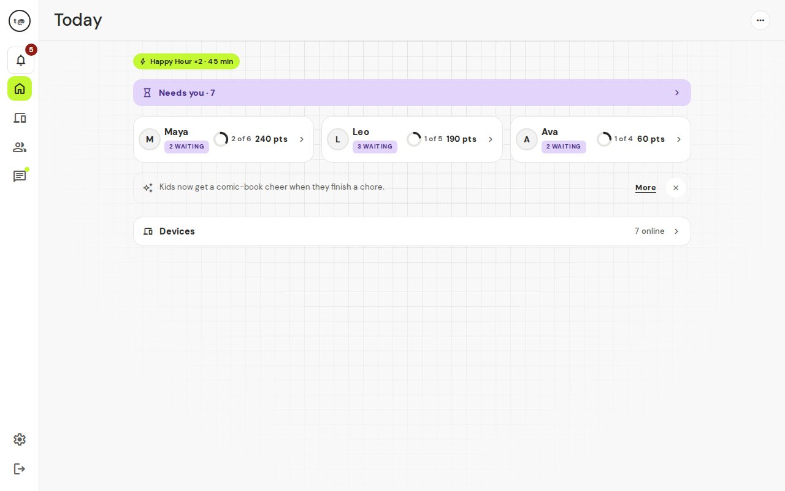

Today starts calm: a **Needs you** bar when something is waiting, one card for each kid, and a **Devices** line. Only a little else shows: a small chip while a Happy Hour runs, and now and then one tip card. A Happy Hour that is running shows as a small chip at the top. To start one, tap the **…** at the top right of Today and choose **Start Happy Hour** (see [Happy Hour](#happy-hour)).

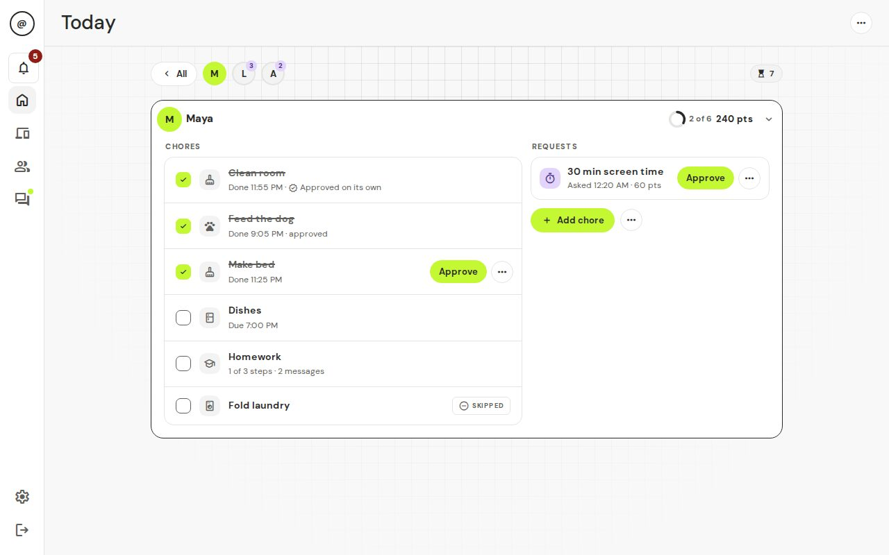

Tap a kid to see their day: how many chores are done, their points, streak and their chores. Tap **All** to go back. Each chore has a chip: **To do**, **Overdue**, **Needs OK**, **Redo**, **Approved** or **Skipped**. Tap a chore to open it. There you can approve it, send it back, mark it done yourself, open its chat or take points away (**Deduct points**).

**View as kid** shows you exactly what that kid sees. **Add chore** makes a new chore for them.

## Needs you

**Needs you** is the list of everything waiting for your decision, from all kids. Tap the **Needs you** bar at the top of Today to open it. It is grouped by kid, oldest first. Each row has one main button, like **Approve**. The less common answers (**Send back**, **Decline**, **Reply**) are in the row's **…** menu.

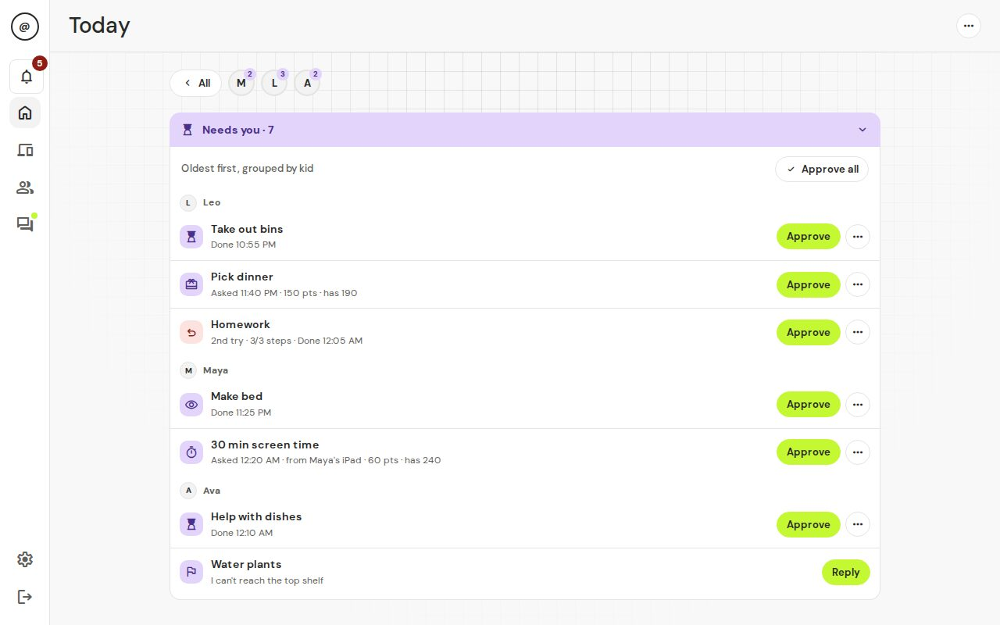

- **Needs OK**: a kid says a chore is done.
- **Redo**: a chore you sent back, done again ("2nd try").
- **Screen time**: a kid asks to spend points on extra minutes.
- **Reward**: a kid asks to cash in points for a reward.
- **Spot check**: a chore that would have approved itself, held back for a quick look. It only appears for kids in trust mode. See [Less tapping](#less-tapping).
- **Note**: a kid tapped **Tell Mom or Dad** on a chore, for example "Need help". Tap **Reply** to answer in the chore's chat.

When more than one thing is waiting, **Approve all** approves them in one go.

A chore a kid finished stays here until you answer it, even after the daily reset. If it is from an earlier day, it shows that day. Approving it later pays the kid as normal, with any Happy Hour bonus from when it was finished. (Before 2.7.0 these were dropped at the reset and the kid got nothing.)

### Approve a chore or send it back

1. Find the chore in **Needs you**. If the kid added a photo, tap it to see it larger.
2. Tap **Approve**, or tap the row's **…** and choose **Send back**.
3. If you send it back, type a short note, like "The sink still has dishes." You can't send it back without a note.

You should see: for Approve, the item disappears and the kid gets their points (and the internet, if that was their last chore). For Send back, the kid sees your note and does the chore again.

Points come to the kid when you approve, not before. If a kid finishes early, they can earn a small bonus. You choose the limit in **Settings → Family**, under **Points rules**.

### Answer a screen time or reward request

Tap **Approve**, or tap the row's **…** and choose **Decline**. The points are only taken when you approve. A declined or ignored request costs nothing.

You should see: the item leaves the list. The kid is told what you decided.

## The bell

The bell shows what happened: chores to approve, kid notes, requests, new devices (not during setup), badges and level-ups, and security alerts such as a device that "got around the lock", "may be a different device", a "tried a VPN" workaround, or someone guessing a parent's password. Use the **All**, **Needs you** and **Alerts** tabs to filter. You can approve right from the bell. Each row has one main button, and **Send back**, **Decline** and **Dismiss** are in its **…** menu. Tap an item to go straight to it. **Mark all read** clears the count.

On a phone the bell opens as a sheet from the bottom of the screen.

## Kids & chores

**Kids & chores** (just **Kids** on a phone) has four tabs: **Chores**, **Kids**, **Rewards** and **Badges**.

### Make a chore once, use it many times

A chore is a few short rows. Open a row to change it.

1. Tap **Kids & chores**, then **Chores**, then **New chore**.
2. In **Basics**, type a **Chore name** and the number of **Points**. Pick a type, like Kitchen or Schoolwork.
3. In **Steps**, add steps if you like (for example "Rinse", "Load", "Wipe"). Each step can have its own due time. Tap **Any order** under a step to make it **Must be done after the step above**. The kid can't say a chore is done until every step is ticked.
4. In **Options**, turn on **Needs a photo** if the kid must show proof. Turn on **Always check** if you always want to look at this chore yourself, even for a kid in trust mode. **Due by** is here too.
5. Tap **Save chore**.

You should see: "Added. Now choose who does it."

Now, in **Who & when**:

1. Pick who does it (one or more kids).
2. If you picked several kids, choose how it works:
   - **Each does it**: every kid gets their own copy and their own points.
   - **First one wins**: one chore for everyone. The first kid to finish it gets the points.
   - **Team effort**: one chore for everyone. Any kid can tick it, and the points are split evenly.
3. Choose **Repeat**: **Every day**, **Some days** (pick the days) or **One time** (pick the date).
4. Tap **Save chore**.

You should see: the chore in the list with the kids' avatars. It appears on Today at your daily reset time (6:00 am unless you changed it in **Settings → Family**).

If you change a chore's name, points or steps, the change shows up everywhere, including today's chores that aren't done yet. **Duplicate** makes a new chore from an old one, handy for "same chore, different points". **Delete** removes it from the list but keeps the history of what was done.

### Kids

Open a kid to see a short page: their points, level and a few rows (**Trust**, **Devices**, **Chores**, **Settings**). Open a row to see more. Tap the **points chip** to see their points history. The buttons at the top:

- **Edit** and **More** (three dots) are at the top. Happy Hour starts from the **…** on Today.
- **Edit**: change their name, avatar, PIN or **Age group** (Little, Kid or Teen).
- **More** holds **Bonus** (give 1 to 500 points with a short note; they get a celebration), **Deduct** (take points away, with a reason the kid can see) and **View as kid**.

## Rewards and screen time

Open **Kids & chores → Rewards**. It has four parts:

- **Requests**: what kids are asking for.
- **Catalogue**: tap **New reward** for things kids can save up for, with a price in points and an icon. Turn off **Needs approval** if a kid can just take it (the points come off right away and you get a ping). Turn off **Kids can see it** to hide it for now.
- **Screen time**: lets kids spend points on extra internet time. It is on for new families (**Kids can buy extra minutes**), and every purchase still needs your OK. The price starts at 20 points for 15 minutes. Turn the switch off and the price, **Max per day**, **Save unused time**, **Save up to**, **Approve automatically** and **Only during allowed hours** settings are hidden until you turn it on again; what you saved is kept. Bought minutes never work during off hours like bedtime.
- **History**: the last 30 days. A chip at the top shows the totals. Pick a kid to filter, and switch between **All**, **Rewards** and **Screen time**. **Export CSV** is the button in the header.

A kid sees a progress bar toward each reward and can ask when they have enough.

### Saving unused time

Kids can save the screen time they didn't buy. It is on by default.

- Each day, the minutes a kid could have bought but didn't are added to their saved time, up to a cap. The default cap is one day's **Max per day**. With a 60 minute max, a kid's biggest day is 120 minutes.
- It needs a **Max per day**, for the family or for that kid (a per-kid limit). A kid with no max (or with screen time off) saves nothing.
- Saved time is room to buy, not free time. Kids still pay points and approval works as usual.
- Each request is still 15 to 120 minutes, so a big day may take two requests.
- You can find it in **Kids & chores → Rewards → Screen time**: **Save unused time** (the switch) and **Save up to** (the cap; leave it empty to use each kid's daily max).
- Turning it off clears all saved time. Turning it on again starts from zero.
- Days the box was off don't add to saved time.
- A request that is still waiting at the daily reset counts as used.
- **Saved: N min** shows next to each kid in **Bought today**.

## Points, levels and badges

- Approved chores earn **points**. Kids spend points on rewards and screen time.
- Lifetime points give **levels**. Spending never lowers a level. The titles go from Rookie up to Mythic.
- **Badges** come automatically (like First Blood for a first approved chore, and On Fire for a streak). They get better in tiers: copper, silver, gold, platinum and mega-diamond.
- A **streak** counts days in a row when every chore was done and approved. Days with no chores do not break it.
- Higher levels unlock flair that kids wear on their name card. See [For kids](05-for-kids.md).
- Kids can see a weekly **leaderboard** of points earned that week. Spending does not count, and it starts again each week.

In **Kids & chores → Badges** you see who has what (**All badges**), what was won lately (**Recent awards**), and **Custom badges**: make your own ("Did the dishes without being asked") and give them by hand. Each time you give the same badge, it moves up a tier.

## Fun and motivation

Chores can get dull after week one. These extras keep them fun. They are all optional and you can turn each one off.

### Celebrations

When a kid finishes a chore, a comic-book moment pops up on their screen: a random character, style, entrance, burst and word (like "YEEHAW!"). Now and then a rare "legendary" one shows up.

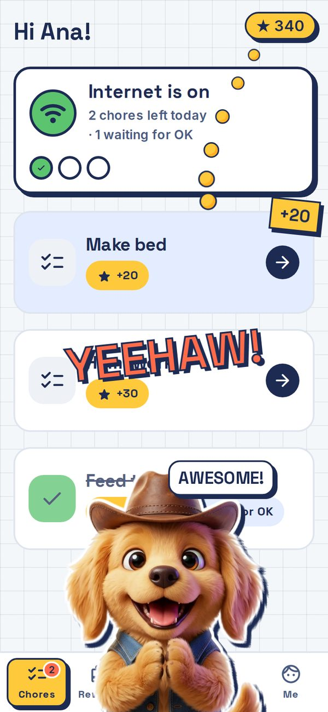

- **Levels** are **Full**, **Small** and **Off**, or **Mode default** (which means Small for teens, Full for the others).
- Set the level for each kid on the kid's page, in the **Settings** row, under **Celebrations**. **Preview a celebration** plays one so you can see it.
- Phones and tablets set to reduce motion get a still badge instead.

### Happy Hour

A Happy Hour gives bonus points for a little while. Tap the **…** at the top right of **Today** and choose **Start Happy Hour**. Pick 30, 60 or 90 minutes and **×1.5**, **×2** or **×3**, for all kids or only the kids you choose.

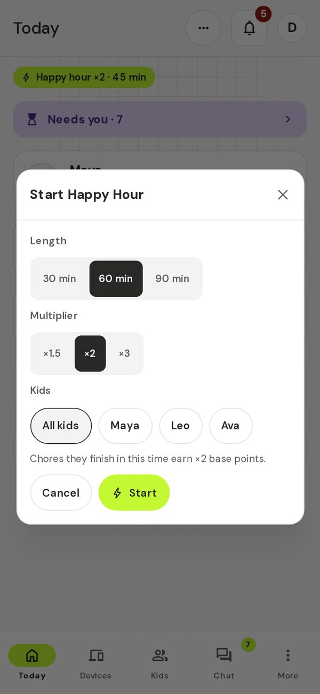

- Chores submitted during the hour earn the bonus on their base points, even if you approve them later.
- Team chores only get the bonus from an all-kids Happy Hour.
- Kids see a banner with a countdown, and their chores show doubled points.
- You can stop it any time. A kid's page only stops the Happy Hours that cover that kid.

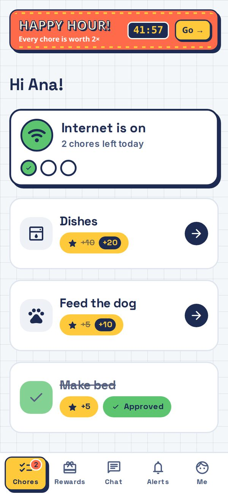

**Auto boost** is on by default. If a kid has two quiet days in a row (days that had chores where none were done), a 1-hour ×2 Happy Hour starts for that kid at 4 pm the next day, and you get a calm notice. It runs at most once a day and twice a week per kid, and it skips kids who were active that day.

**Weekly surprise** starts a surprise Happy Hour once a week. It is off by default.

### Goals

Kids save points toward something bigger, like a bike, a game or a family trip. Open **Kids & chores**, then **Rewards**, then **Goals**.

- **+ New goal** makes a goal with a name, a price and an optional emoji, for one kid, several kids (each gets their own meter) or the whole **Family** (one shared meter).
- Kids can suggest goals. A suggestion shows under **Waiting on you** and on **Today**: tap **Set price** to approve it, or **…** then **Decline**.
- When a meter fills you get a notice. Tap **Fulfilled** once it's done, and the kid gets a mascot party the next time they open the app. A family goal parties for every kid.
- **+ Chip in** adds your own points to a family goal. They don't come from any kid.
- Saved points leave a kid's balance. Removing a goal gives every kid back what they saved.
- **Goal settings** (the link at the bottom) turns Goals on or off and sets whether kids can suggest goals or take points back, whether kids see what siblings gave, automatic saving (a share of each approved chore goes to the kid's chosen goal), how many goals each age can have, and the built-in goals: extra screen time (needs screen time banking) and Get out of jail free.

### Streak freezes

On by default. A kid earns one freeze for every 7 days in a row and can hold 2. A freeze covers a missed day and keeps the streak alive, but it doesn't add a day. Badges count the streak with its freezes.

### "Try this" cards

Cards on **Today** introduce each of these features, at most one new card a day. Dismiss one and it stays gone. The celebrations card has **Turn off for all kids**. That switches celebrations off for your current kids only; kids you add later start with celebrations on.

### Penalties

A penalty takes something away, says why, and lets the kid earn part of it back. It is always your tap; t@sk4ce never gives one on its own. It is off until you turn it on: **Settings → Family → Penalties**. A card on **Today** and setup step 8 also offer it.

- **Give one.** Tap **Give penalty** in the **...** menu on a kid (**Today**), on a chore you are reviewing, on a **Wasn't done** sheet, or on a bypass alert. For something outside the app ("fighting with sister"), use the kid's menu.
- **The sheet.** Pick **Small**, **Medium**, **Big** or **Custom**, then **Give penalty**. Each line below the bar (what is taken, earn-back, reason) has a **change** link that opens just that line. The reason is optional and the kid sees it. If the kid had a penalty in the last 7 days, the next size up is picked and the sheet says "2nd this week". You can change it.
- **Sizes.** Defaults: Small takes 20 points, Medium blocks the kid's devices for 1 day, Big for 3 days. Edit them in **Settings → Family → Penalties**. **Custom** can take points, banked screen time, or block a device or group (up to 14 days). Points and banked time stop at zero.
- **Earn-back.** Choose none, half or all. The kid does make-up chores to get it back: points return, banked time comes back, or a block ends sooner. You pick the make-up chores from a list in **Settings** and can change them for each penalty. Make-up chores always wait for your approval, even in trust mode, and pay nothing else: no points, tickets, streak or badges.
- **On the kid's card.** The kid sees one card on their chores list: what was lost, your reason, an earn-back meter and the make-up chores. A points-only penalty with no earn-back shows once. Kids never see each other's penalties.
- **Forgive, cancel, shorten.** Open the kid's page to see active penalties. **Forgive** ends it now and keeps the record. **Cancel** undoes it, giving back what was taken. **Shorten** (blocks only) ends a block earlier. A blocked device also shows **Blocked by penalty** with **Forgive**. Unfinished make-up chores are cancelled when a penalty ends.
- **Whole family.** Choose **Penalty for everyone** to give the same penalty to every kid. Each kid gets their own penalty, so earn-back is separate.

A block only stops the device's internet. The kid can still open the t@sk4ce kid app, see their card and do make-up chores.

## Where the settings live

- **Kids & chores → Rewards → Happy Hour**: lengths, multiplier, auto boost and weekly surprise.
- **Settings → Family → Points rules → Streak freezes**.
- **Kids & chores → Kids → a kid's page → Settings → Celebrations**.

## Less tapping

Two optional ways to approve less by hand, and a weekly summary. Trust mode and bedtime auto-approve are off until you switch them on. You can offer them in setup (under Tweak, in Optional extras) or later. A card on **Today** suggests each one when it fits.

### Trust mode

Trust mode is per kid. Turn it on in the **Trust** row on the kid's page (**Kids & chores → the kid**). Its level then decides what happens when that kid finishes a chore:

| Level | When the kid finishes a chore |
|---|---|
| **New** | Waits for you, as usual. |
| **Trusted** | Approves itself. 1 chore in 5 stays waiting as a spot check. |
| **Proven** | Approves itself. 1 chore in 20 stays waiting as a spot check. |

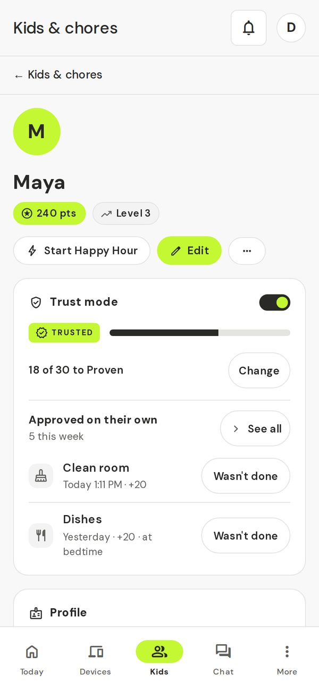

- Everyone starts at **New** with a count of 0. Each chore approved after that counts, whether you approved it or it approved itself. After 10, a New kid becomes **Trusted**. After 30 more, a Trusted kid becomes **Proven**. You and the kid both get a message.
- **Change** sets any level by hand, including Proven on day one.
- Chores with **Always check** always wait for you, at every level.
- A chore that approves itself sends you no alert and isn't in **Needs you**. On **Today** it has a small **Approved on its own** mark. The kid's points, badges and chat line work as normal.
- A spot check is in **Needs you**, marked **Spot check**. A kid sees it like any chore waiting for a parent.
- A team chore approves itself only if every kid on it is in trust mode, and it follows the lowest level.

**Wasn't done.** If a chore approved itself but wasn't really done, tap **Wasn't done** on it (on **Today**, or in **Approved on their own** on the kid's page, which covers the last 7 days). It takes the points back. If the kid already spent them, the balance stops at zero and nothing is owed. By default it also lowers the kid's level one step; untick **Also lower trust level** to keep it. A kid already at New has no level to lower, so the box is hidden, but their count toward Trusted still starts over. The kid gets a gentle message. Badges already earned stay.

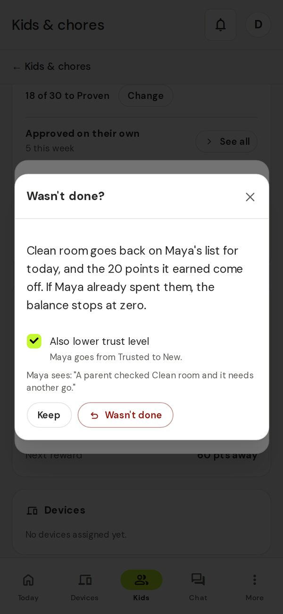

If it is still that chore's day, the chore goes back on the kid's list. When it is done again it always waits for you. On an older day it is closed. Sending back a spot check counts the same way: the kid drops a level. Kids with trust mode off never lose a level.

Kids see their level as a small chip on their **Me** page. See [For kids](05-for-kids.md#trust-level).

### Bedtime auto-approve

At the time you choose (9:00 PM unless you change it), chores still waiting approve themselves. Spot checks and **Always check** chores stay waiting. The kid gets the points, and each one counts as clean for trust mode and can be taken back with **Wasn't done**. It runs once a day. The next morning you get one line in your inbox, like "Bedtime approved 3 chores." It also clears waiting chores from earlier days.

### Weekly recap

Every Sunday at 7:30 PM you get "Your week at (your family)" in your inbox, plus your push and other notification places that already get the daily summary. It is on by default, and quiet hours hold it like any alert. Open it from the link in that message, or any time from **More → Weekly recap**. Use the arrows to see earlier weeks.

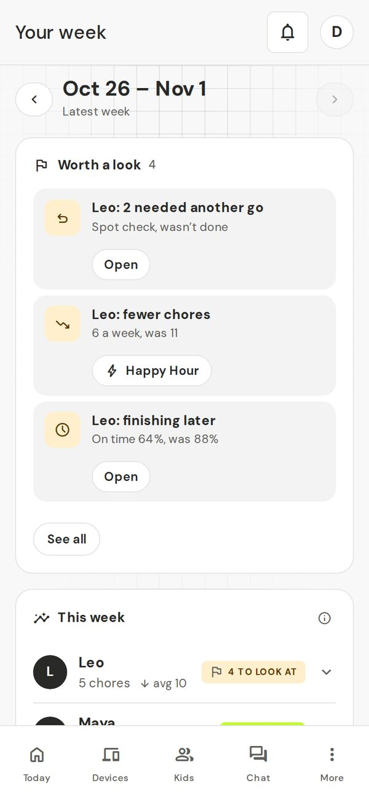

- **Worth a look**: at most 3 things for the whole family, most serious first, each with one tap to act. **See all** shows the rest. If there is nothing, it says "All good this week."
- **This week**: one line for each kid. Tap a kid for chores done, on-time rate, points earned and spent, screen time bought and streak, against the 4 weeks before. A new kid shows the week's numbers and "Trends start after 2 weeks."
- What gets flagged: chores dropping, chores finishing later, 2 or more catches (a **Wasn't done** or a spot check sent back) in a week, and a streak of 7 or more that ended.

### Where the settings live

- **Kids & chores → the kid → Trust**, and **Always check** on each chore.
- **Settings → Family → Bedtime & recap**: **Bedtime auto-approve** (with its time) and **Weekly recap**.

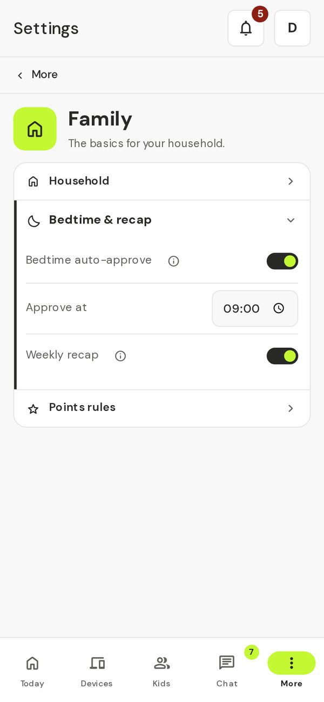

### "Try this" cards

Two more cards on **Today**: one offers trust mode for a kid after 10 approved chores, and one offers bedtime auto-approve if chores were still waiting at the reset on 3 days.

## Devices

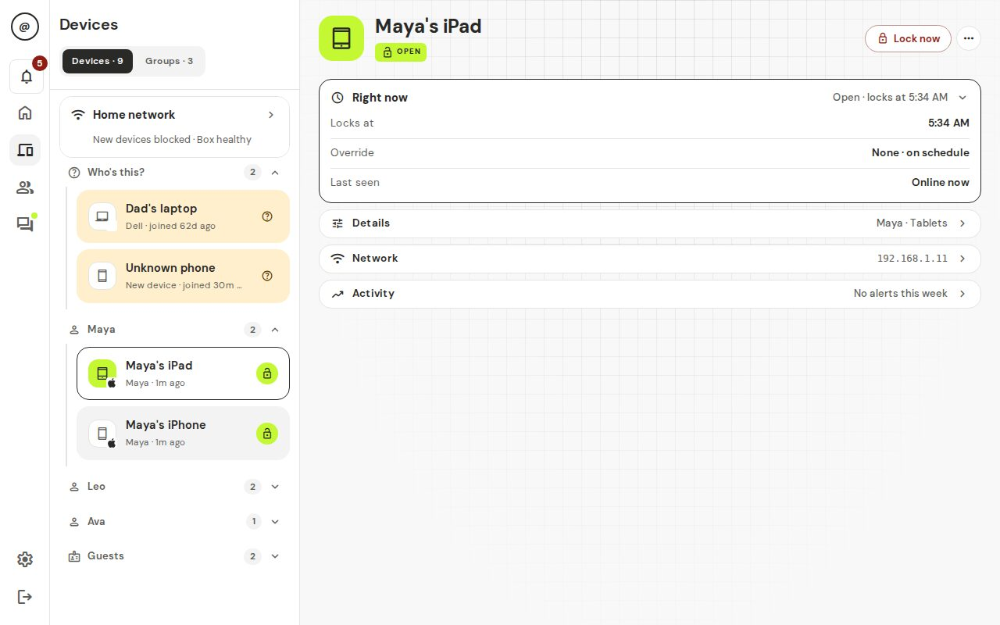

**Devices** lists every device the box has seen, grouped by owner: **Who's this?** (new devices), one group for each kid, **Shared**, **Guests** and **No owner**. New devices stay online until you give them an owner. To pause them until you do, open the **Home network** row at the top of the Devices list and turn on **Block new devices until I assign them**. That row also shows the **Home box** status (Healthy or Offline). It used to be under Settings → Family.

Tap a device to open it:

- **Lock now** pauses it until you change it. **Unlock 30 min** lets it online for half an hour. **Back to schedule** cancels either one.
- **Test block** checks that pausing works for this device.
- **Guest (never blocked)** keeps it online always.
- **Always allowed (never lock)** skips hours and the chore check for this one device, like a kid's laptop for school. A manual lock still works. Guest devices never show this switch, because guests are never locked.
- **Network** and **Activity** show its addresses, when it was online and any alerts.

The **Groups** tab puts several devices together, like "Game consoles", so you can lock them all at once.

### Screen time prices for groups

This is optional, for parents who want it. Some screen time can be worth more than other screen time, so consoles can cost more than a tablet. It is off by default: every device costs the family price.

1. Open **Kids & chores → Rewards → Screen time** and turn on **Different prices for device groups**. Tap **Save**.
2. Tap **Set group prices**. It opens **Devices → Groups**. Tap the group.
3. Type a number in **Screen time price**. It is points for 15 minutes, from 1 to 1000. It saves when you leave the box.

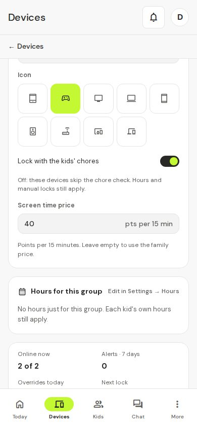

You should see: the price on the group. Leave it empty and the group uses the family price. Turn the switch off again and everything goes back to the family price. The group prices are kept for next time.

- **Free groups:** turn off **Lock with the kids' chores** on a group. Its devices are never locked by chores, so they never cost points and are never offered. They don't count toward any price, and the price box is hidden on that group.
- **What kids see:** when prices differ, the rewards card asks "What for?" and the kid picks one. **All my devices** costs the highest price among their devices. **Other devices** covers their devices that are in no group, at the family price. It shows up only when it is cheaper than **All my devices**.
- **What it unlocks:** **All my devices** unlocks every device the kid has. **Other devices** unlocks only their devices that are in no group. A group unlocks only its own devices. A device in several groups counts at its highest group price, so buying a cheaper group won't unlock it. The kid buys the pricier group or **All my devices**.
- **Price is fixed when the kid asks.** If you change a price later, requests already waiting keep their old cost. If a device has left the group by the time you approve, approving says so; deny the request to give the points back.
- **Deleting a group** cancels the requests still waiting for it. The kid gets their points back.
- **One daily limit:** **Max per day** counts all purchases together.
- **In your inbox:** requests and alerts read like "30 min on Consoles".

The box sees devices, not apps. Two apps on one tablet can't have different prices. See [Troubleshooting](06-troubleshooting.md#why-cant-i-price-youtube-differently-from-homework-on-the-same-tablet).

If the home box stops checking in, a red **Home box offline** message appears at the top. See [Troubleshooting](06-troubleshooting.md#the-app-says-home-box-offline).

## Homework mode

Homework mode opens only the school sites on a device that is paused, for a set time.

1. Open a paused device or a group, tap **…** and pick **Homework 30 min**, **1 hour**, **90 min** or **2 hours**. Or wait for a kid to tap **Ask for homework time** and answer in **Needs you**: **Approve** gives 1 hour, and the row's **…** has the other lengths and **Decline**.
2. Add sites in **Settings → Homework**. "Allowed for everyone" adds to the built-in list. "Never during homework" always wins.
3. For one kid only, open **Kids & chores**, pick the kid and open the **Homework sites** row.

While homework mode is on, the device's status chip says **Homework** (tap it for **Back to schedule**), and the **Homework activity** row shows what was used, so you can block a site or add one.

If you say no to a request, your kid can ask again after 5 minutes.

**Limits.** Big school sites share their servers with other sites (Google, Microsoft, Cloudflare). A determined kid can sometimes reach another site that sits on the same servers. The **Homework activity** row is how you spot that: look for names you don't recognise, then block them or end homework early.

## Hours

**Settings → Hours** sets when devices may be online. Outside these hours, they lock. Each rule has a kind:

- **School nights** and **Weekends**: your everyday hours.
- **Holiday** and **Summer**: these replace everyday hours between the dates you pick. Tap **Add holiday**.
- **Other**: anything else. Tap **Add window**.

Each rule says what it does: **Online**, **Free time** (online even if chores aren't done, like Saturday morning) or **Internet off** (like bedtime). A rule can be for **Everyone**, or for chosen kids or device groups. The timeline shows the whole family's week.

**Lock until today's chores are done** turns the chore check on or off for the whole family.

## Chat

Tap **Chat** to see every conversation:

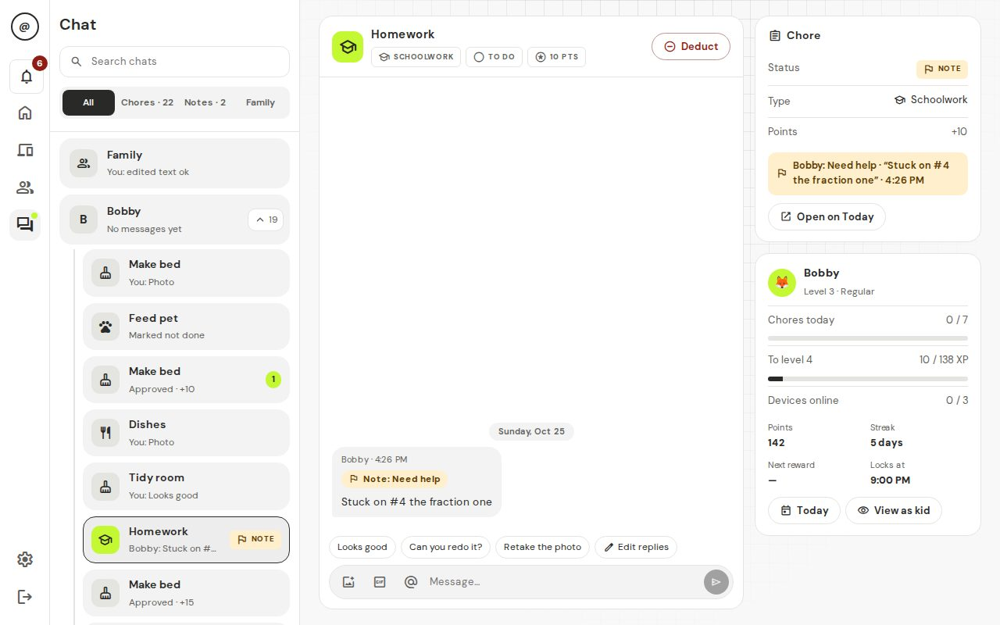

- **Chore threads**: every chore has one. Proof photos, kid notes and your send-back notes show up there. Anyone can add text or photos.
- **Private**: one chat for each kid with the parents. Other kids can't see it.
- **Family**: everyone together.

Use **Chores**, **Notes** and **Family** at the top to filter. Quick replies like "Looks good" save typing. When you open a chore's chat from Today or Needs you, it opens in a panel on a computer, or as a sheet from the bottom on a phone.

### GIFs (off by default)

You can allow GIFs in chat. It's off until you turn it on, and the **GIPHY key** and **GIF rating** settings stay hidden until then.

1. Make a free key at https://developers.giphy.com/ (a GIPHY account is needed).
2. In **Settings → GIFs**, turn on **Allow GIFs in chat**.
3. Paste your key into **GIPHY key**.
4. Pick a **GIF rating**, **G (all ages)** or **PG**.

You should see: a GIF button in chat.

**Privacy note.** When someone searches for a GIF, the search words go to GIPHY through your home box. Kids' devices never talk to GIPHY directly. GIPHY will see your key and the search, but not the kid's device. The rating is checked again on the box before a GIF is sent. Leave GIFs off if you don't want this.

## Notifications

### Pings in your own chat apps

t@sk4ce can send pings to the apps your family already uses, like a Signal group, a Discord channel or email. It uses Apprise, which works with most chat apps and email.

1. Open **Settings → Notifications** and tap **Add a place**.
2. Give it a **Name** and paste an **Apprise address** (the Apprise website lists the format for each app).
3. Choose which events it gets, then tap **Test**. A new place starts with chores to approve, kid notes, reward requests, tricks, a box that goes offline and the daily summary. "New device" alerts are off unless you turn them on (and nothing rings the bell for new devices while you are still in setup).

You should see: a test message in that app.

During **Quiet hours** other pings wait: chores to approve, notes, requests and new devices are sent together when quiet hours end. Security alerts (a device getting around the lock, a different-looking device, password guessing, the box going offline) still send unless you turn off **Security alerts still send**. That switch only shows once quiet hours are on. Pings link back to your box by itself; if the link is wrong, open **When and how** and set **App address** to the address you open t@sk4ce with.

These pings leave your home: they go to the service you chose.

### Alerts on a kid's phone

**Settings → Notifications** also shows a code for each kid. Install the free **ntfy** app on the kid's phone and scan the code with the phone's camera. Alerts then arrive even when t@sk4ce is closed: a chore due soon, approved or sent back, points taken, new chores, messages, a badge or level-up, and a warning in the 10 minutes before the internet goes off. **New code** makes a fresh code; the old one stops working. A kid's page also has a **Phones and tablets** panel with **Add a phone** and **Remove**.

iPhones get these alerts late unless you turn on **Instant alerts on iPhones**. That asks the public ntfy.sh service to wake the phone. Only a wake-up goes out; the alert text stays in your home. If a kid's phone was set up with a code instead, it gets only a short generic line, like "You have a new chore", through the public relay (see below). The ntfy app section in the pane is folded away as **Use the ntfy app instead**.

**Who can read them.** The box's ntfy service (port 2586) has no password, by design. Anyone on your home Wi‑Fi who knows a kid's topic name can read that kid's alerts. The topic is a long random name that works like a password, so keep it secret: only share it by scanning the code. Alerts say things like "Dishes is due soon", never passwords.

**Want a password on it?** Use ntfy's own access control. In `docker-compose.prod.yml`, add to the `ntfy` service's `environment`:

    NTFY_AUTH_FILE: /var/cache/ntfy/user.db
    NTFY_AUTH_DEFAULT_ACCESS: write-only

Then `docker compose -f docker-compose.prod.yml up -d ntfy`, and on the box run `docker compose -f docker-compose.prod.yml exec ntfy ntfy user add pat` and `... exec ntfy ntfy access pat <topic> read-only` for each kid. In the ntfy app, add the box's server with that user's name and password. `write-only` keeps the box able to send without a password; reading needs a login. Details: [ntfy access control](https://docs.ntfy.sh/config/#access-control).

### Kid alerts away from home

Alerts to your kids' phones go through a free public service, ntfy.sh, at home and away. It only sees short, generic lines like "You have a new chore", when they were sent, and your home's internet address. It never sees names, chores, messages or rewards.

Want no outside service? Your box's installer can point it at your own ntfy server (`NTFY_UPSTREAM_URL`, and optionally `NTFY_UPSTREAM_TOKEN`) or turn it off (set it to an empty value). Your server must let anyone read, because phones subscribe without a login. The optional access key is only for sending alerts. A self-hosted ntfy server needs its `upstream-base-url` set for instant iPhone alerts.

A kid whose phone also follows your box's own ntfy topic (the older way) can get the same alert twice, once from each. Phones set up with a code only get it once.

## Add another parent

**Settings → Parents → Invite a parent** makes a link for a partner or grandparent. It works once and lasts 24 hours. Every parent can approve chores, lock devices and change settings.

**Settings → Parents → Your password** changes your own password. Type your old one, then the new one twice. Five wrong tries in 15 minutes sends all parents a security alert.

Next: [For kids](05-for-kids.md).
