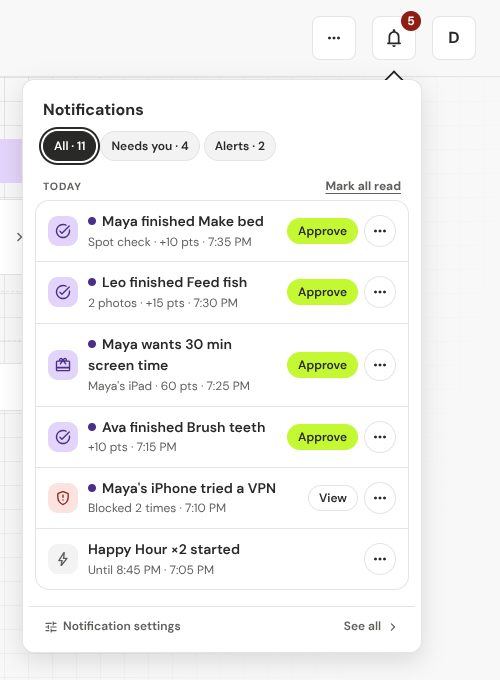
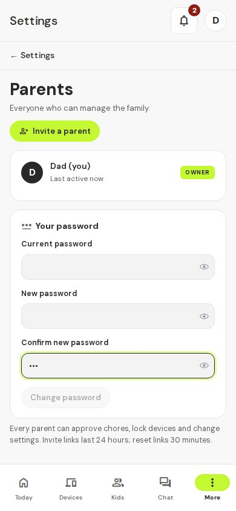

# 6. Troubleshooting

Find your problem below. Each fix is one step at a time.

Commands on this page are typed in the Terminal on the home box (see [Install](02-install.md) if you need to know how to open it). First go to the t@sk4ce folder by typing `cd ~/task4ce` and pressing Enter. Every `docker compose` command below must include `-f docker-compose.prod.yml`, exactly as shown.

If a command says "permission denied" for Docker, put `sudo` in front of it. If it says "no configuration file provided" or "no such file", you are not in the `task4ce` folder.

## I can't find a setting

Screens now show less at first, and open a row for more. Where things moved:

- **Points history** for a kid: tap the points chip at the top of the kid's page.
- **Block new devices** and the **Home box** status: **Devices**, the **Home network** row at the top of the list (no longer in Settings → Family).
- **Bedtime auto-approve** and **Weekly recap**: **Settings → Family → Bedtime & recap** (the old Extras card).
- **Start Happy Hour**: the **…** at the top right of **Today**.
- **Send back**, **Decline** and **Dismiss**: the **…** on a row in Needs you or the bell.
- **Export CSV** of rewards: the button in the header of **Kids & chores → Rewards → History**.
- Quiet hours, and the rest of how pings arrive: **Settings → Notifications → When and how**.

## The app says "Home box offline"

A red message at the top says **Home box offline** and "It went quiet at ...". It means the app has not heard from the box for a minute or two.

**While the box is offline, paused devices may be back online.** The internet just works. Nothing is broken at home.

1. Check the box has power and the network cable is plugged in at both ends.
   You should see: lights on the box and on the router port.
2. Wait two minutes.
   You should see: the message goes away by itself.
3. If it stays, open the Terminal on the box, go to the folder (`cd ~/task4ce`) and type `docker compose -f docker-compose.prod.yml ps`.
   You should see: `blocker`, `backend`, `frontend` and `ntfy` all running.
4. If `blocker` is missing, type `docker compose -f docker-compose.prod.yml up -d blocker`.
   You should see: `Started`.
5. If it keeps stopping, type `docker compose -f docker-compose.prod.yml logs blocker --tail 30` and send it with a new issue on GitHub (see "Still stuck" below).

The most common cause is a wrong network name in the `.env` file. Type `ip route show default`. The word right after `dev` (for example `eth0`) is the network name. Open the file with `nano .env`, fix the `LAN_IFACE=` line, save (Ctrl+O, Enter) and leave (Ctrl+X). Then run `docker compose -f docker-compose.prod.yml up -d blocker`.

## A device isn't being paused

Work through these in order:

1. Is the device **assigned** to a kid? Guests are never paused. New devices are paused only if **Block new devices until I assign them** is on (**Devices → Home network**).
2. Are all that kid's chores approved for today? If yes, the internet is on. If the kid has no chores today, it is also on.
3. Is **Lock until today's chores are done** off in **Settings → Hours**? Then only the hours count. Is it inside a **Free time** window?
4. Open the device. Is **Always allowed (never lock)** on? Do you see **Back to schedule**? That means someone unlocked it by hand: tap **Back to schedule**.
5. Did the kid buy screen time? It shows under **Kids & chores → Rewards → Screen time**.
6. Press **Test block** on the device and read the answer:
   - "We haven't seen this device on the network yet, so we couldn't test it.": the box can't see it. Wake the device and join your Wi-Fi.
   - "Success — the device lost internet access while blocked.": it works.
   - "The device is trying to get around the block. The box is still stopping it, but someone may have changed its network settings.": see below.
   - "We couldn't see this device use the internet during the test. ...": open a video on the device and test again. If it repeats, your router may be stopping the box. Check the [router list](../routers.md).

## My kid found a way around it

This can happen. t@sk4ce stops normal use, and tells you when it notices. It can't stop everything.

If a paused device keeps reaching the internet, you get a notification, "<device> got around the lock", and a red "got around the lock" chip on the device. It clears by itself once the device stops.

What kids try, and what happens (details in [the home box notes](../blocker.md)):

- Changing network settings or using a VPN app: does not work.
- Forgetting the Wi-Fi to get a new address: the new address looks like a new device and starts paused.
- Using a phone hotspot or mobile data: **not covered**. It is only home Wi-Fi.
- Using another device that isn't set up: **not covered**. Put every device on the Devices page.
- Unplugging the box: the internet comes back on, and you get an alert.

## "May be a different device" alert

A device's reported type changed, for example an iPad that now looks like a MacBook. Someone may have copied its address. This alert ignores quiet hours, and you get it at most once a day per device.

1. Open the device. Its **Activity** tab shows the old and new type.
2. Check the device is the one you expect. A software update alone does not cause this alert.
3. If it is the right device, nothing more to do. If not, change the owner or remove it, and talk with your kid.



## "Tried a VPN" alert

The box saw a paused device look up a VPN, private-DNS ("DNS" is the internet's phone book), proxy site or Tor name. It was already blocked. Nothing is broken.

1. Open the device to see which one it tried.
2. Talk with your kid. You get one alert per kind per pause, so it won't repeat while the device stays paused.
3. To stop these, turn off **Tried a workaround** in **Settings → Notifications**.

The box can't notice a VPN app that goes straight to a number address, a device that isn't paused, or a sibling's spare device.

## "Someone is guessing my password"

Someone typed a wrong password for your account 5 times in 15 minutes. You get this at most once an hour. Kid accounts don't trigger it.

1. If it was you, ignore it.
2. If not, tap **Change password** on the alert. It opens **Settings → Parents → Your password**.
3. Pick a new, long password. Ask your kids if they were trying.



The real fix is a talk. If you see the alert, ask. Keep the box out of reach.

## Why can't I price YouTube differently from homework on the same tablet?

The box sees devices, not apps. It can't tell YouTube from a homework app on one tablet, so the tablet has one price.

1. To price them apart, put the apps on separate devices, like a cheap tablet for homework.
2. Put each device in its own group, then set a **Screen time price** on each group. See [Everyday use](04-everyday-use.md).

You should see: kids pick the group in "What for?" when they ask for time.

## I forgot my password

**If there is another parent:**

1. They sign in and tap **Settings**, then **Parents**.
2. They tap **Reset link** next to your name, then **Copy link**.
   You should see: a link and the words "It works once, for 30 minutes."
3. They send you the link. Open it, type a new password twice and tap **Save password**.
   You should see: the log in page with "Password saved. Log in with your new password."

**If you are the only parent**, type this on the home box (in the `task4ce` folder), with your username in place of `mom` (the user name you chose in setup, not your display name):

```bash
docker compose -f docker-compose.prod.yml exec backend python -m app.cli reset-password mom
```

You should see: a link. Open it on your phone or computer, and choose a new password. If the name is wrong, the box shows the parent names it knows.

If the link says it has expired, make a new one. Each new link cancels the old one.

## A kid forgot their PIN

1. Sign in as a parent. Tap **Kids & chores**, then **Kids**, then the kid, then **Edit**.
2. Type a new 4-digit PIN and save, or tap **Remove PIN**.
   You should see: the kid can sign in with the new PIN.

## A kid can't open their page

1. Make sure the device is assigned to that kid on the **Devices** page. Kids can only sign in from their own devices.
2. After too many wrong PINs the app says "Too many tries. Wait a minute and try again." Wait a minute.

## The box code doesn't work

1. Look at the sticker on the box again. Dashes and capital letters don't matter, but a 0 and an O look alike.
2. Check you are scanning the sticker for this box.
3. Still no luck? Ask the person who set the box up for the code.

You should see: the page moves on to making your parent account.

## Too many tries

After too many wrong codes the app says to wait. Wait a few minutes, then try again with the code from the sticker.

## The kid's code expired or was already used

A kid's code works once and only for 24 hours. The phone says "Ask a parent for a new code."

1. Sign in as a parent. Open the kid's page and find **Phones and tablets**, or use the **Kids' phones** step of setup.
2. Tap **Show code** or **New code**, and scan it again on the kid's phone.

## I can't add it to my home screen

Adding to the home screen needs the box's secure address (starts with `https`). A box opened by its number address (an IP address such as `http://192.168.1.50:3000`) can't do it. Open it with the **Open my box** code on the sticker instead. See [Install](02-install.md).

## The iPhone icon asks me to sign in

An iPhone or iPad keeps the home-screen icon apart from Safari, so the icon starts empty. Open the icon, tap **I have a code**, and type the short code (like `AB3D-7KMN`) the welcome page showed after you scanned. The code works once and runs out after 15 minutes. If it ran out, a parent makes a new QR code (see above) and you scan it again.

## A lost phone

Open the kid's page, find **Phones and tablets**, and tap **Remove** next to the phone. It signs out right away. The phone shows "This phone was removed. Ask a parent for a new code." To add a phone back, scan a new code.

## Backups

Your family's information lives in one data store on the box. Before any upgrade that changes the database, the app saves a copy in `backups`, named `pre-upgrade-<time>.db`, inside that data store.

To keep your own copy, type this in the `task4ce` folder on the box:

```bash
mkdir -p ~/tskfrce-backup
docker compose -f docker-compose.prod.yml cp backend:/app/data ~/tskfrce-backup/
```

You should see: a folder `~/tskfrce-backup/data` with a file ending `.db`. Copy that folder to a USB stick now and then.

## Start over

This erases everything, including the chores and points. Do this only if you really want to.

```bash
cd ~/task4ce
docker compose -f docker-compose.prod.yml down -v
```

Then run the install line from [Install](02-install.md) again. You will see the setup wizard like the first time.

## Still stuck

Open an issue at https://github.com/JMO-Labs/tskfrce/issues and tell us what you see. For router problems, use the [router report](https://github.com/JMO-Labs/tskfrce/issues/new?labels=router).
