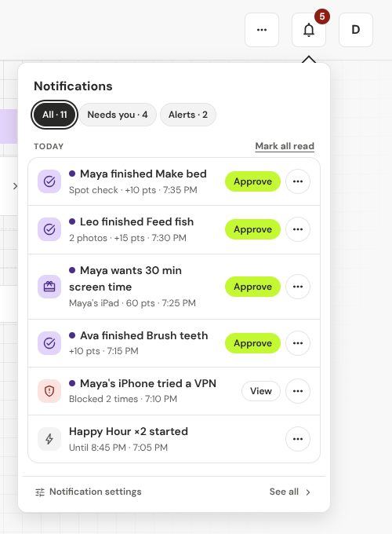
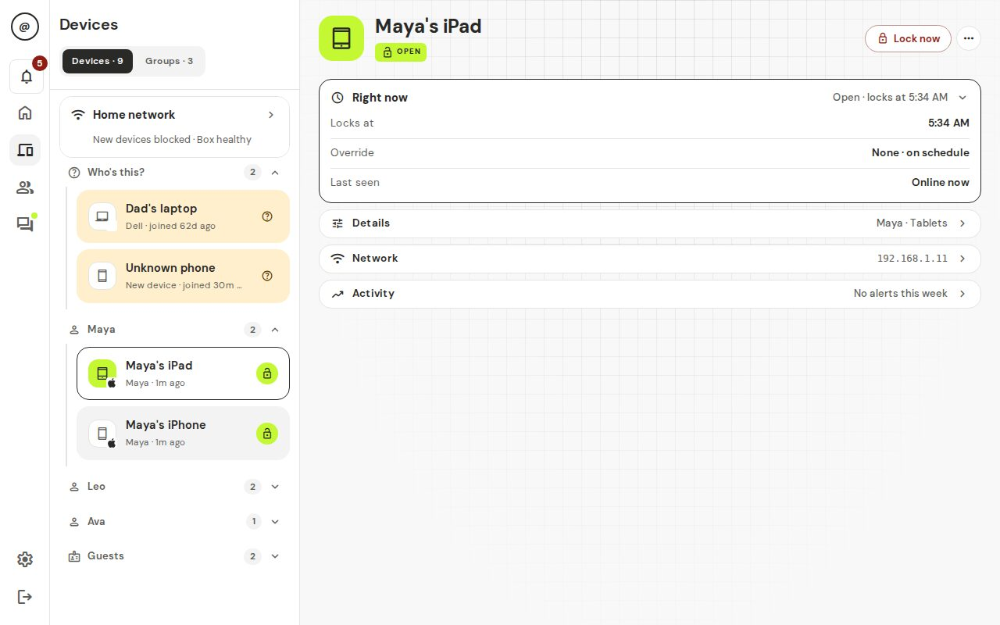

# Bypass alerts

A bypass alert tells you that a paused device is still reaching the internet, or is trying to. The box keeps blocking it. The alert tells you that someone may be working around the lock.

## Who it is for

Any parent. Alerts show in the bell, and a new notification place gets them by default. You do not need to set anything up.

## What counts as a bypass

- **Got around the lock.** A device that should be paused was still reaching the internet. Often someone changed its network settings or used a VPN. The box locks it again.
- **New address right after locking.** A "new device" with the same name showed up soon after a device was locked. It may be the same device with a new Wi-Fi address.
- **May be a different device.** A device looks like another one that used the same address. Worth a look.
- **Tried a VPN (or private DNS, a proxy site, Tor) — blocked.** A paused device tried one of these tricks and the box stopped it. The pause is still on.

## Turn it on or off

The bell always shows them. You choose which of your notification places also get them:

1. Open **Settings → Notifications**.
2. Add or edit a place (see [Notifications](../04-everyday-use.md#notifications)) and choose which events it gets. **Security alerts** and **Tried a workaround** are the two that matter here.
3. If you use **Quiet hours**, turn on **Security alerts still send** if you want these to come through at night. That switch only shows once quiet hours are on.

## Walk-through: you got an alert

1. Tap the bell. Open the **Alerts** tab. Security alerts show with a red icon and the label **Security alert**.
2. Tap **View**. You land on that device.
3. Open the **Activity** row. Use the **Bypass** filter to see the events. The top shows **Bypass attempts · 7d**.
4. Decide what to do. In the alert's **…** menu you can:
   - **Ask (kid's name)** in chat.
   - **Give penalty** (see [penalties](../04-everyday-use.md)).
   - **Lock all (kid's name)'s devices**.
   - **Dismiss** the alert.
5. On a "May be a different device" event, pick **Same device, merge** or **Different device**. On other events, **Mark OK** clears it.

On the device, the status chip says **Got around the lock** while it is happening. Tap it for **See activity ›** and **Lock now**.

## What your kid sees

Nothing special. The alert goes to parents. The device simply stays paused.

## Limits and gotchas

- A phone with a random Wi-Fi address ("Private Wi-Fi Address") can look like a new device after a lock. On that device, turn that setting off for your home network. A device's **Network** row says **Random Wi-Fi address** when it applies.
- If your router stops the box from doing its job, you can also see a device that "stayed online". See [Routers](routers.md).

## FAQ

**Does the alert mean my kid did something wrong?** Not always. A new phone Wi-Fi address can trigger it. Use **Ask (kid's name)** first.

**Can I stop the alerts for one device?** Use **Dismiss** on each alert. There is no switch for one device.

**Where do I see older ones?** On the device, open **Activity**. The counts cover the last 7 days.

Back to [feature guides](README.md).
