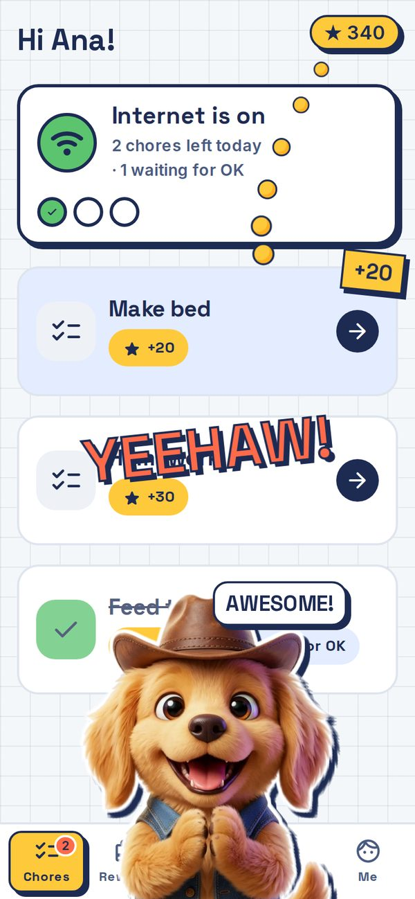
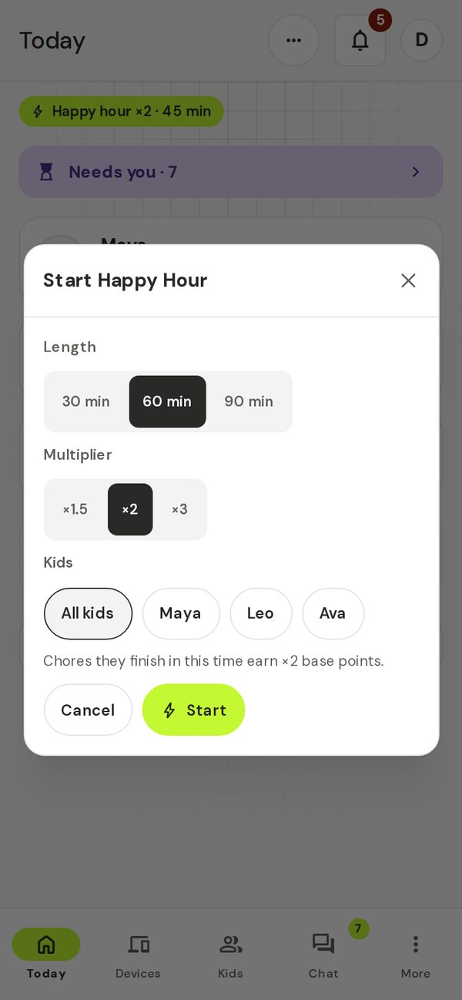
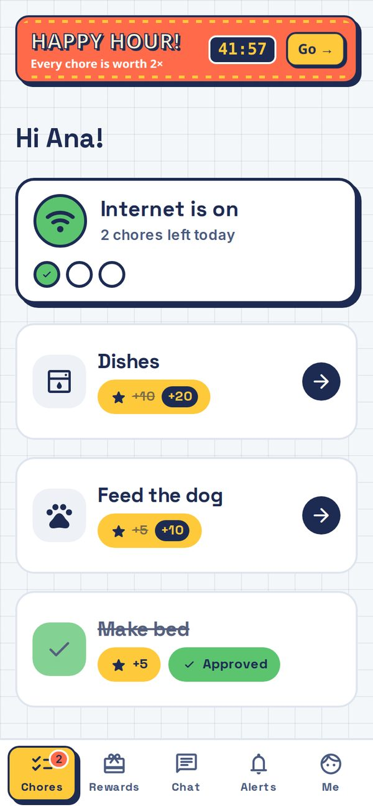

# Rewards and celebrations

The excitement pack makes chores feel like a win. When a kid finishes something, their screen pops. You can also start a **Happy Hour**, when chores earn extra points for a while.

**Who it's for:** any family whose kids find chores dull. Everything here is optional and each part can be turned off.

## Celebrations

A comic-book moment appears on the kid's screen when a chore is approved or you give a bonus. It picks a random character, style, entrance, burst and word (like "YEEHAW!"). Now and then a rare "legendary" one shows up. Kids also get one for badges and new levels.

### Turn it on, off or down

For each kid:

1. Open **Kids & chores**, then **Kids**, then the kid.
2. In the **Settings** row, find **Celebrations**.
3. Pick **Full**, **Small**, **Off** or **Mode default**.

- **Full** has the characters, bursts and words.
- **Small** is a lighter version.
- **Off** shows nothing.
- **Mode default** is Full, or Small for teens.

Tap **Preview a celebration** to play a random one on your own screen. Nothing is sent to your kid.

To switch it off for everyone at once, use **Turn off for all kids** on the celebrations card on **Today**. That only changes the kids you have now. Kids you add later start with celebrations on.

### What the kid sees

- A full-screen pop with the character and word, then their points.
- Kids can change their own level too: **Me** tab, **Fun**, **Celebrations**: **Full**, **Small** or **Off**. Teens also get a **Mascots** switch.
- A phone or tablet set to reduce motion shows a still badge instead.

## Happy Hour

A Happy Hour gives bonus points for a short time.

### Start one

1. On **Today**, tap **…** at the top right and choose **Start Happy Hour**.
2. Pick the **Length**: 30, 60 or 90 min.
3. Pick the **Multiplier**: ×1.5, ×2 or ×3.
4. Under **Kids**, keep **All kids** or tap the kids you want.
5. Tap **Start**.

Tap the Happy Hour chip on **Today** to stop it early. On a kid's page you only stop the Happy Hours that cover that kid.

### What the kid sees

A banner with a countdown. Their chores show the boosted points.

### Set your defaults and the automatic ones

Open **Kids & chores**, then **Rewards**, then **Happy Hour**.

- **Default multiplier** and **Default length** fill in the Start sheet for you.
- **Auto boost when things go quiet** is on by default. After 2 quiet days in a row (days with chores where none were done), a 1-hour ×2 Happy Hour starts for that kid at 4 pm the next day, and you get a notice. It runs at most once a day and twice a week per kid, and skips kids who were active.
- **Surprise Happy Hour once a week** is off by default. It starts one on a random weekday afternoon.

## Limits and gotchas

- The bonus is on a chore's **base** points and counts when the kid **submits** the chore, even if you approve it later.
- Team chores only get the bonus from an all-kids Happy Hour.
- Celebrations are per kid. Turning one kid off does not change the others.
- Cards on **Today** introduce these features, at most one new card a day. Dismiss one and it stays gone.

## FAQ

**My teen finds the cartoons babyish.** Leave them on **Mode default** (Small for teens) or choose **Off**.

**Can I see what my kid will see?** Yes: **Preview a celebration**.

**I approved a chore after the Happy Hour ended. Did they lose the bonus?** No. It counts from when they submitted it.

**Can a kid turn their own celebrations off?** Yes, in the **Me** tab under **Fun**.

Back to [everyday use](../04-everyday-use.md#fun-and-motivation).
