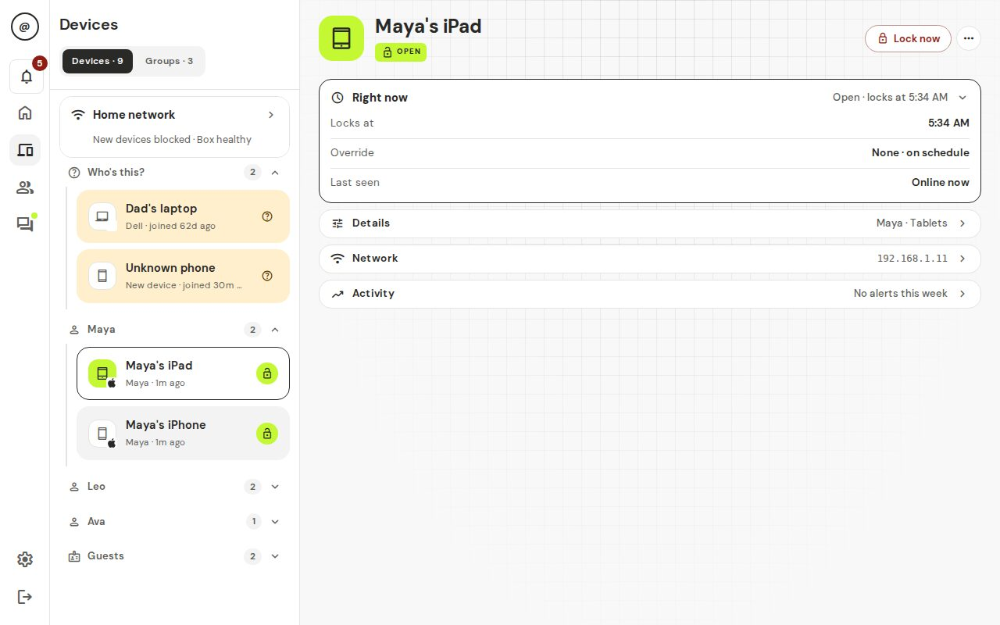

# Routers

The home box pauses a device by stepping in between it and your router. Some routers get in the way. **Test block** tells you whether the pause really works.

## Who it is for

Any parent, once, after adding the box. Do it again if you change routers or a device seems to stay online when paused.

## Run Test block

1. Open **Devices** and open the device you want to test.
2. Tap **…** and pick **Test block**. The menu item says **Testing…** while it runs.
3. Wait for the message. The test briefly blocks the device, watches it, and puts everything back as it was.

## Read the result

- **Success — the device lost internet access while blocked.** The pause works.
- **We haven't seen this device on the network yet, so we couldn't test it.** Wake the device, join the Wi-Fi, and try again.
- **The device is trying to get around the block.** The box is still stopping it, but someone may have changed its network settings. See [Bypass alerts](bypass-alerts.md).
- **We couldn't see this device use the internet during the test.** Open a video on it and test again. If you see it again, your router may be stopping the box.
- **The home box didn't answer. Is it plugged in?** Check the box's power and cable. **Devices → Home network** shows the **Home box** as **Healthy** or **Offline**.

## Which routers

| Router | Works? | Notes |
|---|---|---|
| Most ISP routers | Works | None |
| Eero (mesh) | Often resists | Try disabling "Client steering", or use a wired box |
| Google Wifi / Nest Wifi | Often resists | None |
| UniFi with "Client device isolation" | Resists until isolation is off | Turn off "Client device isolation" for the network the box is on |
| Asus AiMesh | Usually works | None |

The same list is in the [router compatibility notes](https://github.com/JMO-Labs/tskfrce/blob/main/docs/routers.md).

## What your kid sees

Their device is blocked for about 10 seconds during the test, then goes back to how it was.

## Limits and gotchas

- The test needs the device to be on the Wi-Fi and awake.
- A phone with a random Wi-Fi address can confuse the result. Turn off "Private Wi-Fi Address" for your home network on it.
- If your router is not listed, tell us: [open a router report](https://github.com/JMO-Labs/tskfrce/issues/new?labels=router). Include the router's make and model, and what **Test block** said.

## FAQ

**Is Test block safe?** Yes. It does not change your settings.

**Do I need to test every device?** No. One device usually tells you if the router is the problem.

**My router is "Often resists". Is it hopeless?** No. Try the note in the table first.

Back to [feature guides](README.md).
